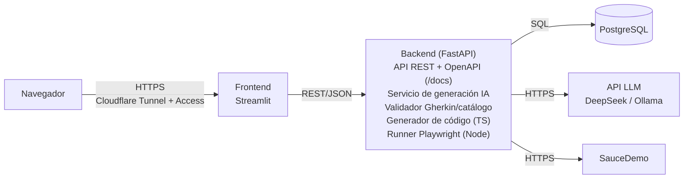

# QA Copilot

Aplicación web full stack que asiste a un analista QA: a partir de una historia de usuario, un LLM propone casos de prueba Gherkin en español, el sistema los valida contra un catálogo cerrado de pasos, la persona los revisa y aprueba, y se exportan a un script de Playwright (TypeScript) generado por plantillas para ejecutarlos contra [SauceDemo](https://www.saucedemo.com) y ver los resultados en un panel.

> **Principio rector: la IA propone, el sistema valida y la persona decide.** El LLM nunca escribe código ejecutable.

Proyecto final de Prácticas de Laboratorio · Tecnicatura en Programación de Computadoras · Universidad de Belgrano · 2026. La especificación completa está en [`docs/spec.md`](docs/spec.md).

## Arquitectura

Tres contenedores (frontend, backend y base de datos) y dos servicios externos. El frontend no accede a la base: toda la lógica vive en la API.



Más diagramas en [`docs/uml/`](docs/uml/): [casos de uso](docs/uml/casos-de-uso.md), [clases](docs/uml/clases.md), [estados del caso](docs/uml/estados-caso.md) y [despliegue](docs/uml/despliegue.md).

## Stack

| Capa | Tecnología |
|---|---|
| Frontend | Streamlit 1.66 (multipágina con `st.navigation`), httpx |
| Backend | Python 3.12, FastAPI, Pydantic v2, pydantic-settings, SQLAlchemy 2 (sincrónico), Alembic, psycopg 3, uvicorn |
| Base de datos | PostgreSQL 16 |
| Automatización | Playwright Test 1.64 con TypeScript, Chromium headless (imagen oficial de Playwright) |
| Calidad | pytest, ruff |
| Infraestructura | Docker Compose, Dokploy, Cloudflare Tunnel |

Las versiones exactas están fijadas en `backend/pyproject.toml`, `frontend/pyproject.toml`, `backend/playwright/package.json` y los `Dockerfile`.

## Requisitos

- Docker con el plugin Docker Compose (v2 o superior).
- `make` (opcional, para los atajos).

## Puesta en marcha

```bash
cp .env.example .env
# editar .env: como mínimo, cambiar POSTGRES_PASSWORD (y la misma contraseña en DATABASE_URL)
docker compose up --build
```

El backend espera a la base, aplica las migraciones y carga las tres historias de ejemplo en el primer arranque. Si los puertos 8000 u 8501 están ocupados en tu máquina, cambiá `BACKEND_PORT` / `FRONTEND_PORT` en `.env` (y `API_PUBLIC_URL` si cambiás el del backend).

### URLs locales

| Servicio | URL |
|---|---|
| Interfaz (Streamlit) | http://localhost:8501 |
| Documentación de la API (Swagger) | http://localhost:8000/docs |
| Estado del servicio | http://localhost:8000/salud |

## Comandos (Makefile)

Todos operan vía `docker compose` sobre los contenedores en ejecución (salvo `up`).

| Comando | Qué hace |
|---|---|
| `make up` | Construye y levanta los servicios en segundo plano |
| `make down` | Detiene y elimina los contenedores (conserva los datos) |
| `make logs` | Muestra los logs |
| `make test` | Corre las pruebas del backend (pytest, contra la base `qa_copilot_test`) |
| `make lint` | `ruff check` y `ruff format --check` en backend y frontend |
| `make format` | Aplica el formato y las correcciones de ruff |
| `make migrate` | Aplica las migraciones y verifica que no haya cambios pendientes |
| `make revision m="..."` | Genera una migración con autogenerate |
| `make psql` | Abre `psql` dentro del contenedor de la base |
| `make smoke` | Ejecuta el smoke test de Playwright dentro del backend |

Para empezar de cero (borrando los datos): `docker compose down -v`.

## Estructura del repositorio

```
├── docker-compose.yml        # db + backend + frontend
├── Makefile                  # atajos vía docker compose
├── .env.example              # variables de entorno documentadas (sin secretos)
├── backend/
│   ├── Dockerfile            # imagen de Playwright + Python 3.12 en /opt/venv
│   ├── docker-entrypoint.sh  # espera la base, migra, carga ejemplos, inicia uvicorn
│   ├── alembic/              # migraciones
│   ├── app/
│   │   ├── main.py           # aplicación FastAPI
│   │   ├── config.py         # Settings (variables de entorno)
│   │   ├── db.py             # engine, sesión y Base
│   │   ├── models/           # entidades SQLAlchemy y estados (StrEnum)
│   │   ├── schemas/          # modelos Pydantic de entrada y salida
│   │   ├── routers/          # endpoints HTTP
│   │   ├── services/         # lógica de negocio
│   │   └── seed.py           # historias de ejemplo (idempotente)
│   ├── playwright/           # proyecto Playwright (smoke en S3, runner en S5)
│   └── tests/                # pytest contra PostgreSQL real
├── frontend/
│   ├── Inicio.py             # punto de entrada y navegación
│   ├── paginas/              # Panel, Historias, Detalle, Ejecuciones, Catálogo, Acerca de
│   └── lib/                  # api.py (cliente HTTP único), formato y rutas
├── catalogo/                 # catálogo de pasos de SauceDemo (S4)
└── docs/                     # spec, bitácora, guía de despliegue y UML
```

## Estado actual

| Semana | Objetivo | Estado |
|---|---|---|
| S3 | Repositorio, Docker Compose, modelo de datos, historias (RF-01), esqueleto de pantallas, spike de Playwright, UML iniciales | ✅ Hecho |
| S4 | Catálogo de pasos, integración con DeepSeek, generación, validación y revisión humana | Pendiente |
| S5 | Generador TypeScript, runner de Playwright, resultados con capturas | Pendiente |
| S6 | Panel y reportes, modo demo, regeneración, historial, Cloudflare Access y límite diario | Pendiente |
| S7 | Pruebas, corrección de errores, presentaciones y demo pregrabada | Pendiente |
| S8 | Verificación final y defensa (26/11/2026) | Pendiente |

El detalle semanal está en la [bitácora](docs/bitacora.md). El despliegue se describe en [`docs/deploy-dokploy.md`](docs/deploy-dokploy.md).

## Uso de IA en el desarrollo

Tal como pide la cátedra, se declaran las herramientas de IA utilizadas:

| Uso | Herramienta | Finalidad |
|---|---|---|
| Componente del producto | DeepSeek (API) / Ollama | Proponer casos de prueba, siempre sujetos a validación automática y aprobación humana. |
| Asistencia en el desarrollo | Claude (Anthropic) | Análisis de requisitos y redacción de la especificación. |
| Asistencia en el desarrollo | Claude Code | Asistente de código: estructura del proyecto, implementación guiada por la especificación, pruebas y documentación, con revisión del autor. |
