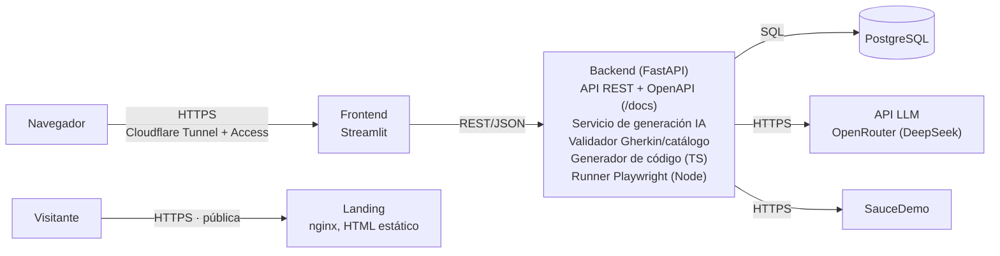

# Casewright

> Durante el desarrollo el proyecto se llamó **QA Copilot**. El nombre se conserva en los identificadores técnicos (paquetes, imágenes y servicios); la especificación v1.0 ya usa Casewright.

Aplicación web full stack que asiste a un analista QA: a partir de una historia de usuario, un LLM propone casos de prueba Gherkin en español, el sistema los valida contra un catálogo cerrado de pasos, la persona los revisa y aprueba, y se exportan a un script de Playwright (TypeScript) generado por plantillas para ejecutarlos contra [SauceDemo](https://www.saucedemo.com) y ver los resultados en un panel.

> URL de Landing Page: https://casewright.ordema.app/
> URL de Producto: https://qa.ordema.app/

> **Principio rector: la IA propone, el sistema valida y la persona decide.** El LLM nunca escribe código ejecutable.

Proyecto final de Prácticas de Laboratorio · Tecnicatura en Programación de Computadoras · Universidad de Belgrano · 2026. La especificación completa (v1.0, alcance cerrado) está en [`docs/spec.md`](docs/spec.md) y en Word en [`docs/Casewright_Spec_v1.0.docx`](docs/Casewright_Spec_v1.0.docx).

## Arquitectura

Tres contenedores de la aplicación (frontend, backend y base de datos), un cuarto con la landing estática del producto y dos servicios externos. El frontend no accede a la base: toda la lógica vive en la API.



Más diagramas en [`docs/uml/`](docs/uml/): [casos de uso](docs/uml/casos-de-uso.md), [clases](docs/uml/clases.md), [estados del caso](docs/uml/estados-caso.md), [secuencia de generación y revisión](docs/uml/secuencia-generacion.md), [secuencia de exportación y ejecución](docs/uml/secuencia-ejecucion.md) y [despliegue](docs/uml/despliegue.md).

## Stack

| Capa | Tecnología |
|---|---|
| Frontend | Streamlit 1.66 (multipágina con `st.navigation`), httpx |
| Backend | Python 3.12, FastAPI, Pydantic v2, pydantic-settings, SQLAlchemy 2 (sincrónico), Alembic, psycopg 3, uvicorn |
| Base de datos | PostgreSQL 16 |
| Automatización | Playwright Test 1.64 con TypeScript 7.0 (solo `tsc --noEmit`), Chromium headless (imagen oficial de Playwright) |
| Calidad | pytest, ruff |
| Landing | HTML estático con Tailwind (Play CDN) servido por nginx 1.30 |
| Infraestructura | Docker Compose, Dokploy, Cloudflare Tunnel |

Las versiones exactas están fijadas en `backend/pyproject.toml`, `frontend/pyproject.toml`, `backend/playwright/package.json` y los `Dockerfile`.

## Requisitos

- Docker con el plugin Docker Compose (v2 o superior).
- `make` (opcional, para los atajos).

## Puesta en marcha

```bash
cp .env.example .env
# editar .env: como mínimo, cambiar POSTGRES_PASSWORD (y la misma contraseña en DATABASE_URL)
docker compose up --build
```

El backend espera a la base, aplica las migraciones y carga las tres historias de ejemplo en el primer arranque. Si los puertos 8000 u 8501 están ocupados en tu máquina, cambiá `BACKEND_PORT` / `FRONTEND_PORT` en `.env` (y `API_PUBLIC_URL` si cambiás el del backend).

### URLs locales

| Servicio | URL |
|---|---|
| Interfaz (Streamlit) | http://localhost:8501 |
| Landing | http://localhost:8080 |
| Documentación de la API (Swagger) | http://localhost:8000/docs |
| Estado del servicio | http://localhost:8000/salud |

## Comandos (Makefile)

Todos operan vía `docker compose` sobre los contenedores en ejecución (salvo `up`).

| Comando | Qué hace |
|---|---|
| `make up` | Construye y levanta los servicios en segundo plano |
| `make down` | Detiene y elimina los contenedores (conserva los datos) |
| `make logs` | Muestra los logs |
| `make test` | Corre las pruebas del backend (pytest, contra la base `qa_copilot_test`) |
| `make lint` | `ruff check` y `ruff format --check` en backend y frontend |
| `make format` | Aplica el formato y las correcciones de ruff |
| `make migrate` | Aplica las migraciones y verifica que no haya cambios pendientes |
| `make revision m="..."` | Genera una migración con autogenerate |
| `make psql` | Abre `psql` dentro del contenedor de la base |
| `make smoke` | Ejecuta el smoke test de Playwright dentro del backend |

Para empezar de cero (borrando los datos): `docker compose down -v`.

## LLM

La generación usa un proveedor compatible con la API de OpenAI y se configura en `.env` con las variables de `.env.example`:

- `LLM_PROVIDER=openrouter` y `LLM_API_KEY` usan OpenRouter con DeepSeek.
- `LLM_PROVIDER=deepseek` usa la API directa de DeepSeek.
- `LLM_PROVIDER=demo` devuelve respuestas pregrabadas para las tres historias de ejemplo y no necesita clave.
- `DAILY_GENERATION_LIMIT` limita las generaciones por día (RNF-08). El valor 0 significa sin límite.

La clave solo va en `.env` o en las variables de Dokploy. Nunca se versiona.

## Catálogo de pasos

`backend/catalogo/saucedemo.yaml` es la lista cerrada de pasos que puede usar un caso (RF-02). Cada paso tiene:

| Campo | Qué es |
|---|---|
| `id` | Identificador único en snake_case. |
| `grupo` | Pantalla del SUT a la que pertenece el paso. Agrupa el catálogo en el prompt y en la pantalla Catálogo. |
| `patron` | Texto del paso sin la palabra clave (Dado, Cuando, Entonces, Y o Pero). Admite como máximo un parámetro, escrito `"{texto}"` y entre comillas. |
| `plantilla` | Código Playwright que se genera al exportar. `{texto}` se reemplaza por el valor del caso escapado como literal. |

El bloque `contexto` lleva los datos reales del SUT (usuarios, mensajes, productos) que el prompt le pasa al LLM.

Para agregar o cambiar un paso:

1. Verificá el selector en la aplicación.
2. Editá el YAML y subí `version`.
3. Corré `make test` y reconstruí el backend con `docker compose up --build -d backend`. El catálogo se carga al iniciar el backend, y si el archivo es inválido el backend no arranca y registra el motivo.

El catálogo no se edita desde la interfaz (spec 3.3).

## Exportación y ejecución

- **Exportar** (`GET /historias/{id}/export`, botón «Descargar .spec.ts» en el Detalle): genera `HU-n.spec.ts` con un `test` por caso aprobado y un `test.step` por paso Gherkin. El código sale de las plantillas del catálogo y los valores van como literales escapados.
- **Ejecutar** (`POST /historias/{id}/ejecuciones`, botón «Ejecutar pruebas»): corre ese mismo archivo en segundo plano contra SauceDemo con Chromium headless. Hay una sola ejecución a la vez, 30 s por test y un tope de 10 minutos.
- **Resultados** (pantalla Ejecuciones, `GET /ejecuciones/{id}`): cada caso queda aprobado, fallido u omitido, con su duración. Los fallidos muestran el paso que falló y la captura de pantalla (`GET /evidencias/{id}`).
- Las evidencias de cada ejecución (`.spec.ts`, `reporte.json` y capturas) quedan en el volumen `evidencias`, en `/data/evidencias/ejecuciones/<id>/`.

Para correr un archivo exportado fuera de la aplicación alcanza con un proyecto de Playwright con `baseURL: 'https://www.saucedemo.com'`.

## Panel e historial

- **Panel** (RF-09): métricas generales, una tabla por historia con los casos por estado y el resultado de su última ejecución, y las últimas ejecuciones con aprobados, fallidos, omitidos y % de éxito. Las filas llevan al Detalle o a la ejecución. Los datos salen de `GET /historias`, que incluye `ultima_ejecucion`, y de `GET /ejecuciones`.
- **Historial de generaciones** (RF-12, desplegable en el Detalle, `GET /historias/{id}/generaciones`): fecha, proveedor, modelo, versión del prompt, duración, resultado y casos válidos e inválidos de cada generación, incluidas las fallidas.
- **Regenerar** (RF-11): reemplaza los casos pendientes y conserva los aprobados y descartados. Si un pendiente ya se había ejecutado, sus resultados quedan en esa ejecución como «Caso reemplazado al regenerar».

## Estructura del repositorio

```
├── docker-compose.yml        # db + backend + frontend + landing
├── Makefile                  # atajos vía docker compose
├── .env.example              # variables de entorno documentadas (sin secretos)
├── backend/
│   ├── Dockerfile            # imagen de Playwright + Python 3.12 en /opt/venv
│   ├── docker-entrypoint.sh  # espera la base, migra, carga ejemplos, inicia uvicorn
│   ├── alembic/              # migraciones
│   ├── app/
│   │   ├── main.py           # aplicación FastAPI
│   │   ├── config.py         # Settings (variables de entorno)
│   │   ├── db.py             # engine, sesión y Base
│   │   ├── models/           # entidades SQLAlchemy y estados (StrEnum)
│   │   ├── schemas/          # modelos Pydantic de entrada y salida
│   │   ├── routers/          # endpoints HTTP
│   │   ├── services/         # lógica de negocio
│   │   └── seed.py           # historias de ejemplo (idempotente)
│   ├── catalogo/             # catálogo de pasos de SauceDemo (YAML versionado, RF-02)
│   ├── prompts/              # prompt de sistema versionado (v1.md)
│   ├── demo/                 # respuestas pregrabadas del modo demo
│   ├── playwright/           # proyecto Playwright: config, smoke, tsconfig y carpeta de trabajo del runner
│   └── tests/                # pytest contra PostgreSQL real
├── frontend/
│   ├── Inicio.py             # punto de entrada y navegación
│   ├── paginas/              # Panel, Historias, Detalle, Ejecuciones, Catálogo, Acerca de
│   └── lib/                  # api.py (cliente HTTP único), formato y rutas
├── landing/                  # landing pública: index.html y Dockerfile de nginx
└── docs/                     # spec, bitácora, guía de despliegue y UML
```

## Estado actual

| Semana | Objetivo | Estado |
|---|---|---|
| S3 | Repositorio, Docker Compose, modelo de datos, historias (RF-01), esqueleto de pantallas, spike de Playwright, UML iniciales | ✅ Hecho |
| S4 | Catálogo de pasos, integración con DeepSeek (vía OpenRouter), generación, validación y revisión humana | ✅ Hecho |
| S5 | Generador TypeScript, runner de Playwright, resultados con capturas | ✅ Hecho |
| S6 | Panel y reportes, modo demo, regeneración, historial, Cloudflare Access y límite diario | ✅ Hecho (Cloudflare Access, límite diario, modo demo y regeneración adelantados en S4) |
| S7 | Pruebas, corrección de errores, presentaciones y demo pregrabada | Pendiente |
| S8 | Verificación final y defensa (26/11/2026) | Pendiente |

El detalle semanal está en la [bitácora](docs/bitacora.md). El despliegue se describe en [`docs/deploy-dokploy.md`](docs/deploy-dokploy.md).

## Uso de IA en el desarrollo

Tal como pide la cátedra, se declaran las herramientas de IA utilizadas:

| Uso | Herramienta | Finalidad |
|---|---|---|
| Componente del producto | DeepSeek vía OpenRouter (`deepseek/deepseek-v4.1-flash-1017`) | Proponer casos de prueba, siempre sujetos a validación automática y aprobación humana. |
| Asistencia en el desarrollo | Claude (Anthropic) | Análisis de requisitos y redacción de la especificación. |
| Asistencia en el desarrollo | Claude Code | Asistente de código: estructura del proyecto, implementación guiada por la especificación, pruebas y documentación, con revisión del autor. |
