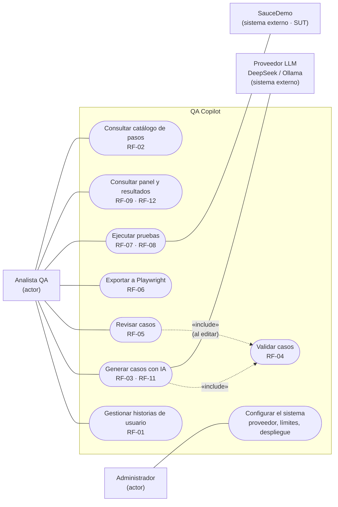

# Diagrama de casos de uso

Casos de uso del MVP de QA Copilot con sus actores (spec, secciones 2.3 y 5). Mermaid no tiene un diagrama de casos de uso nativo: se representa con un *flowchart* donde los rectángulos son actores, los óvalos son casos de uso y el recuadro es el límite del sistema.

