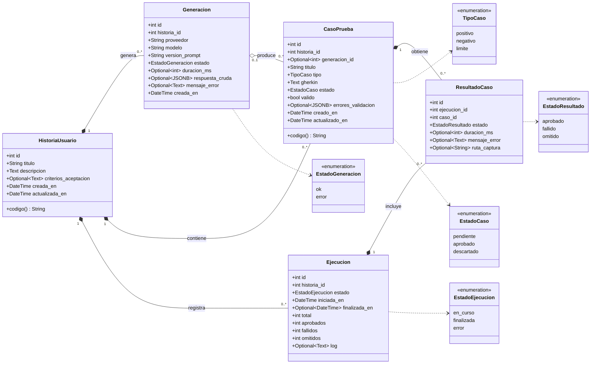

# Diagrama de clases (modelo de dominio)

Las cinco entidades persistidas en PostgreSQL (spec, sección 8) con sus atributos, multiplicidades y los valores válidos de cada estado. Los identificadores visibles `HU-n` y `CP-n` se calculan a partir del `id`; no se guardan.

Composición (`*--`): al borrar la historia se borran en cascada sus generaciones, casos y ejecuciones (`ON DELETE CASCADE`). Agregación (`o--`): si se borra una generación, sus casos se conservan con `generacion_id` en nulo.
