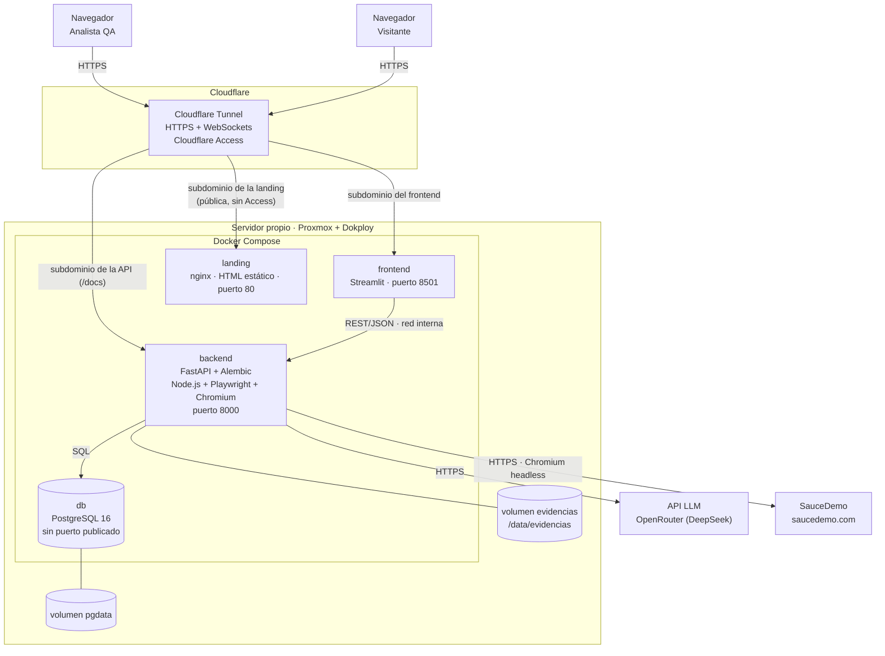

# Diagrama de componentes y despliegue

Despliegue en el servidor propio (Proxmox + Dokploy) con Docker Compose, publicado mediante Cloudflare Tunnel (spec, sección 4 y RNF-02). Muestra los cuatro contenedores, sus volúmenes y los servicios externos. La landing es pública; la interfaz y la API están detrás de Cloudflare Access.

