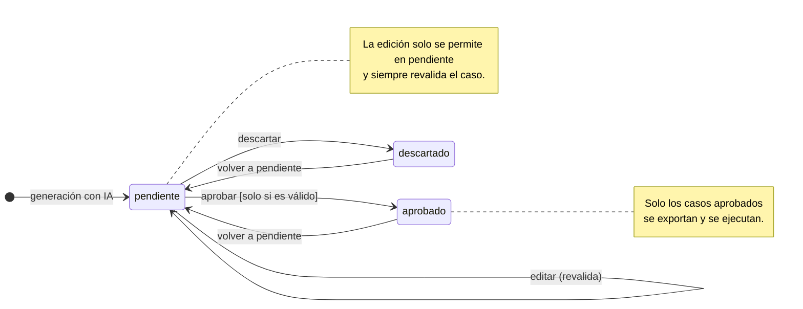

# Diagrama de estados del caso de prueba

Ciclo de vida de un caso de prueba durante la revisión humana (spec, sección 8.1 y RF-05). El atributo `valido` lo calcula el validador (RF-04) y condiciona la aprobación.

