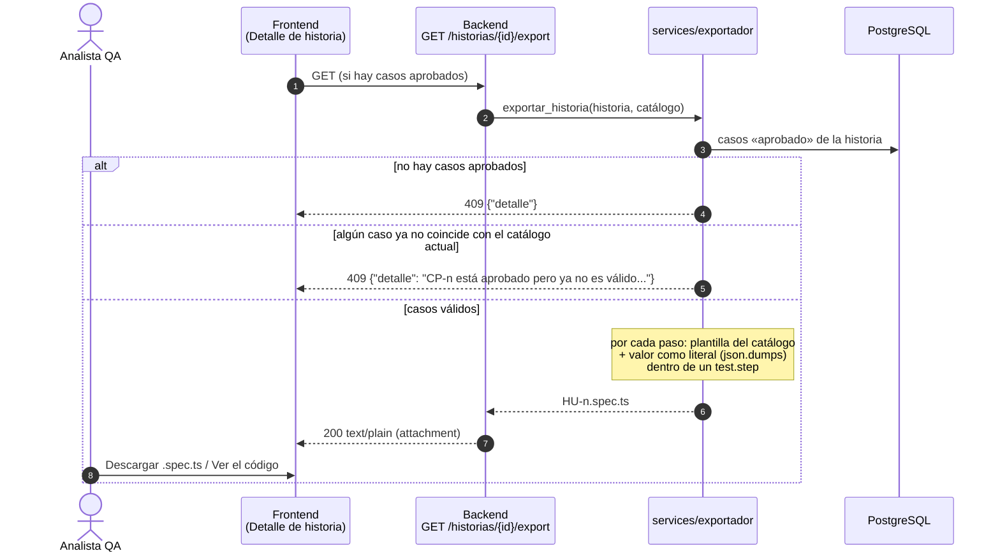
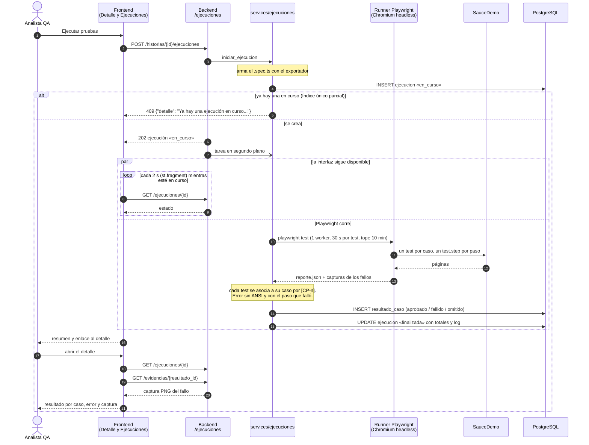
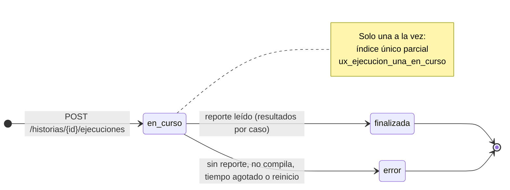

# Diagrama de secuencia: exportación y ejecución

Flujo de RF-06 a RF-08 tal como está implementado en S5. El `.spec.ts` sale de las plantillas del catálogo y es el mismo archivo que se descarga y el que se ejecuta. Playwright corre en segundo plano, así que la interfaz no se bloquea.

## Exportación (RF-06)

## Ejecución y resultados (RF-07, RF-08)

Si Playwright no genera el reporte, si el archivo no compila o si supera el tope de 10 minutos, la ejecución queda en «error» con el log. Si el backend se reinicia durante una ejecución, al arrancar la marca como «error» (`app/recuperar.py`), así la regla de una a la vez no bloquea las siguientes.

## Estados de la ejecución

