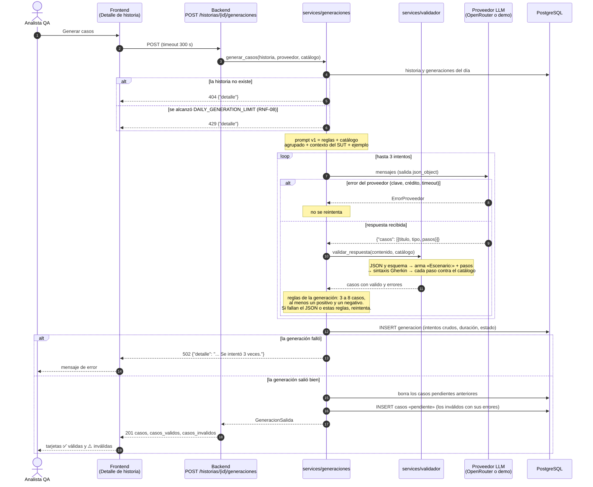
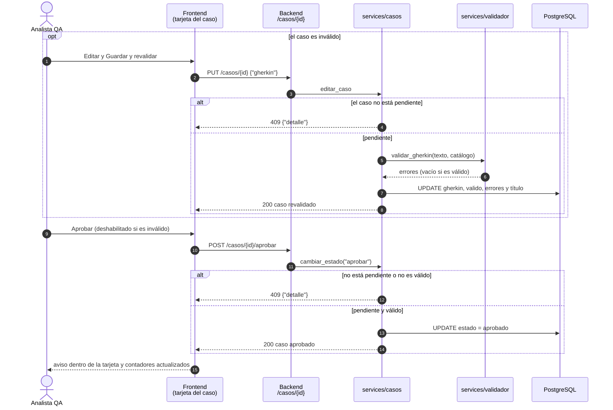

# Diagrama de secuencia: generación y revisión de casos

Flujo de RF-03 a RF-05 tal como está implementado en S4. El LLM solo propone pasos en JSON: el backend arma el Gherkin, lo valida contra el catálogo y la persona decide qué se aprueba.

## Generación con IA (RF-03, RF-04)

Un caso es inválido cuando un paso no coincide con ningún patrón del catálogo, aunque el JSON sea correcto. Queda guardado igual, con sus errores, para que la persona lo corrija o lo descarte. Al regenerar se conservan los casos aprobados y descartados (RF-11).

## Revisión humana (RF-05)

Descartar y volver a pendiente siguen el mismo camino con `POST /casos/{id}/descartar` y `POST /casos/{id}/pendiente`. Las transiciones permitidas están en el [diagrama de estados](estados-caso.md).
